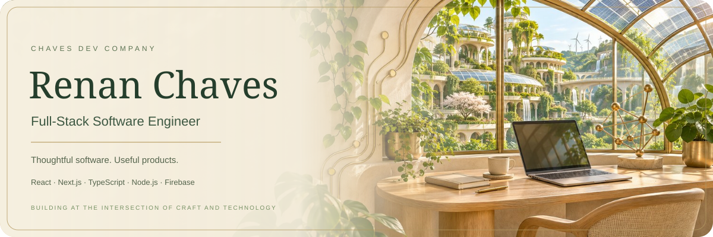
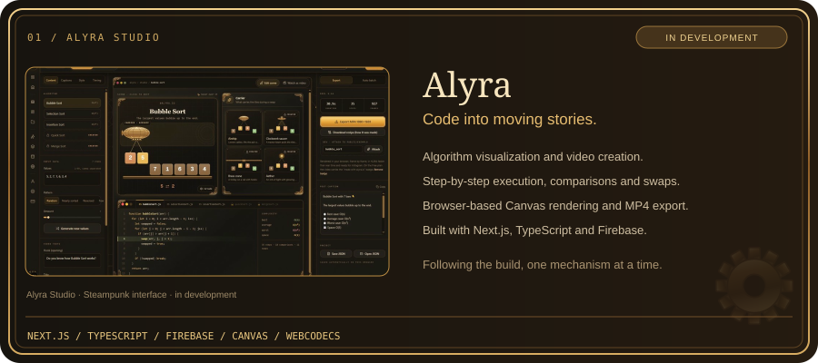
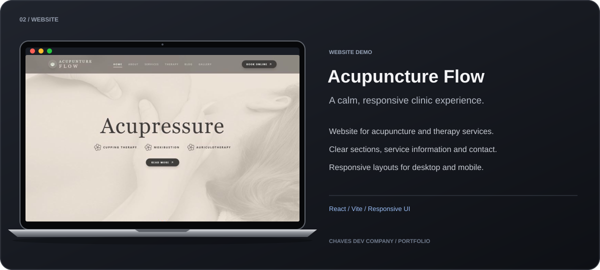
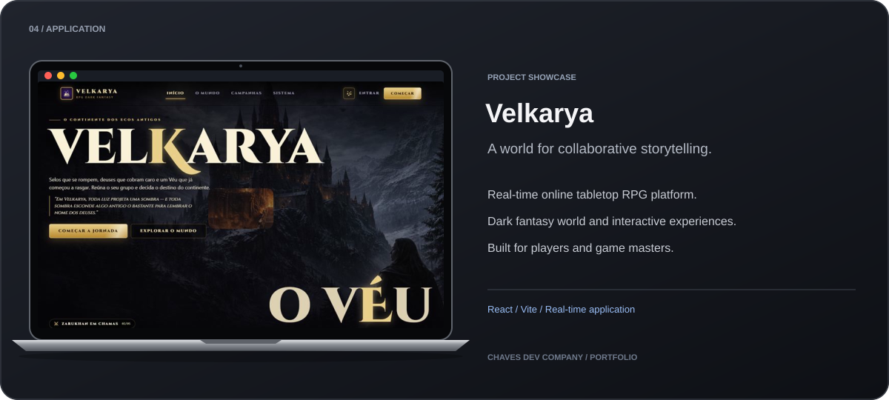

  

## 🧭 About me

- 🛠️ Founder and engineer at **Chaves Dev Company**: 14+ websites and web apps delivered for clients in legal, healthcare, fitness, automotive, construction, education and e-commerce.
- 🎲 Creator of **Velkarya**, a real-time online tabletop RPG platform, and **Alyra**, a SaaS that turns algorithms into videos.
- 🧱 I care about clean architecture, reusable components, performance and interfaces people actually enjoy using.
- 🎓 Technologist in Systems Analysis and Development (IFSP) · 🇧🇷 Portuguese (native) · 🇺🇸 English (C1)
- 💼 Open to **full-stack, front-end and back-end** opportunities.

## ⭐ Featured work

  

  

  

  

Click a card to open the live project · <a href="https://chavesdev.vercel.app/AllWorks"><b>See all 14+ projects in my portfolio →</b></a>

## 🧰 Tech stack

  

💬 Have a product idea or an open role? <a href="mailto:contactrenchaves@gmail.com">Let's talk.</a>

