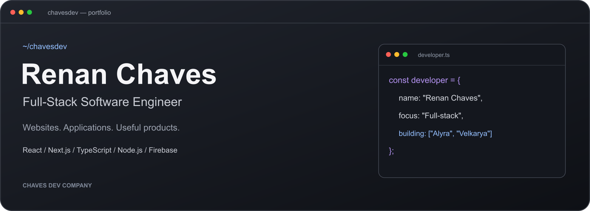
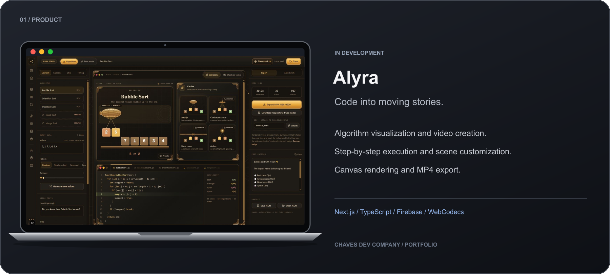
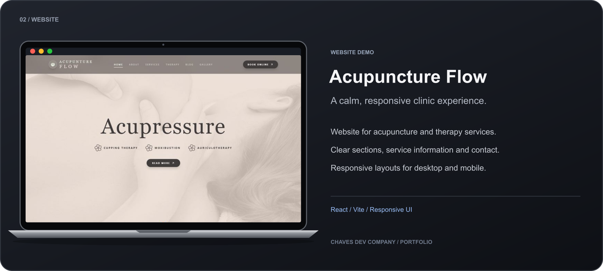
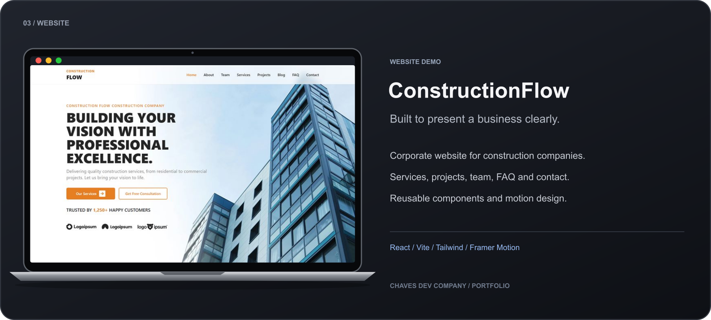
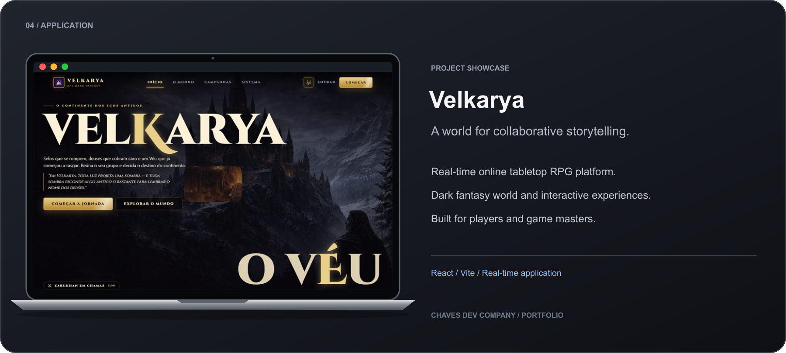
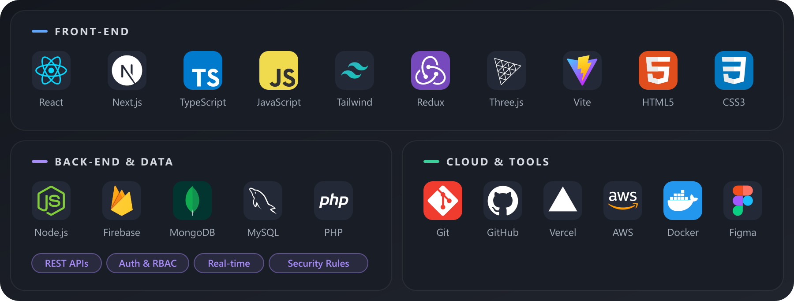

 

## Building useful things, with care

I'm **Renan Chaves**, a full-stack software engineer and founder of **Chaves Dev Company**.

- My portfolio spans **14 websites and web applications** across legal, healthcare, fitness, automotive, construction, education and e-commerce themes.
- I'm building **Alyra**, a SaaS that turns algorithms into visual explanations and videos, and **Velkarya**, a real-time online tabletop RPG platform.
- I care about clean architecture, reusable components, performance and interfaces people enjoy using.
- Technologist in Systems Analysis and Development (**IFSP**) · Portuguese (native) · English (C1).
- Open to **full-stack, front-end and back-end** opportunities.

## Featured work

  

  

  

  

The linked project cards open their websites. Alyra is still in development. <a href="https://chavesdev.vercel.app/AllWorks"><b>Explore the full portfolio →</b></a>

## Tools I work with

 

**Have a product idea or an open role?** [Let's talk.](mailto:contactrenchaves@gmail.com)

Software with craft. Products with purpose.

